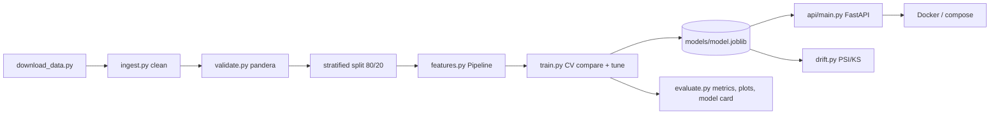

# Customer Churn Prediction: End-to-End ML Pipeline

Data → validation → one sklearn Pipeline → model comparison/tuning → evaluation → FastAPI service → Docker → CI.
Dataset: IBM Telco Customer Churn (7,043 customers, ~26.5% churn). If the download fails, `data/download_data.py` generates a synthetic dataset with the same schema, so everything still runs offline.

## Architecture


## Setup
```bash
make install      # pip install -r requirements-dev.txt
make train        # download data, validate, compare 3 models, tune, evaluate, save to models/
make test         # pytest (27 tests, no network needed)
make lint         # ruff
make serve        # API at http://localhost:8000  (docs: /docs)
make docker       # docker compose up --build (run `make train` first)
make drift CSV=path/to/new.csv   # PSI/KS drift report vs training data
```

## API examples
```bash
curl localhost:8000/health
curl localhost:8000/model-info
curl -X POST localhost:8000/predict -H 'Content-Type: application/json' -d '{
  "gender":"Female","SeniorCitizen":0,"Partner":"Yes","Dependents":"No","tenure":5,
  "PhoneService":"Yes","MultipleLines":"No","InternetService":"Fiber optic",
  "OnlineSecurity":"No","OnlineBackup":"No","DeviceProtection":"No","TechSupport":"No",
  "StreamingTV":"Yes","StreamingMovies":"Yes","Contract":"Month-to-month",
  "PaperlessBilling":"Yes","PaymentMethod":"Electronic check",
  "MonthlyCharges":89.5,"TotalCharges":450.2}'
# -> {"churn_probability":0.9015,"churn":true,"label":"Yes","version":"1.0-..."}
# batch: POST /predict/batch with {"customers":[{...},{...}]}  (1 to 1000 rows)
```
Errors: invalid input → `422 {"detail":"Invalid request","errors":[{"field","message"}]}`; model missing → `503`; unexpected failure → `500 {"detail":"Internal server error"}` (details only in logs).

## Docker
`Dockerfile`: multi-stage (builder venv → slim runtime), non-root user (uid 10001), `HEALTHCHECK` on `/health`. `docker-compose.yml` mounts `./models` read-only. Run `make train` first so a model exists.
*Note: Docker was not available in the environment where this was built, so the Docker files were written but not executed.*

## Results (hold-out test set, 1,409 customers, real data)
| Model (5-fold CV, train) | ROC-AUC | PR-AUC | F1 |
|---|---|---|---|
| **LogisticRegression** (selected) | **0.846** | 0.660 | 0.628 |
| GradientBoosting | 0.843 | 0.657 | 0.626 |
| RandomForest | 0.821 | 0.608 | 0.533 |

| Final model: tuned LogisticRegression (C=10) | Test |
|---|---|
| Accuracy | 0.740 |
| Precision | 0.506 |
| Recall | 0.783 |
| F1 | 0.615 |
| ROC-AUC | 0.841 |
| PR-AUC | 0.627 |

Plots in `reports/`; model card in `models/model_card.md`.

## Design decisions
- **One Pipeline** (impute → scale/one-hot → model) saved as a single joblib with version, timestamp, threshold and test metrics. Train and serve cannot diverge.
- **No leakage:** split first; CV re-clones the whole pipeline per fold; the preprocessor is fit on train only (tested).
- **Imbalance:** `class_weight` for LR/RF, balanced `sample_weight` for GB. Threshold stays at 0.5 (recall-friendly); probabilities are not calibrated.
- **Model choice by CV ROC-AUC**, then light `RandomizedSearchCV` (12 iters, 3-fold) on the winner only.
- **Cleaning:** blank `TotalCharges` occurs only for tenure 0, so it is set to 0; anything else stays NaN and is imputed in the pipeline (so the API accepts a missing `TotalCharges`).
- **Validation:** pandera `strict` schema (types, ranges, allowed categories, nulls, unique IDs) raises `ValueError` listing failures. API input is validated separately by pydantic.
- **Model loaded once** at startup; app stays up with `/health` = 503 if the model file is missing.
- Extra files beyond the spec: `requirements-dev.txt` (keeps the Docker image lean), `pyproject.toml` (pytest + ruff config), `tests/test_drift.py`.
- Logistic regression winning is plausible: the signal is mostly linear (contract, tenure, charges).

## Future improvements
Probability calibration + cost-based threshold; experiment tracking (MLflow); time-based validation; scheduled drift monitoring that triggers retraining; model registry and canary deploys; auth + rate limiting on the API; fairness audit (`gender` is currently a feature); SHAP explanations per prediction.

## Resume summary
- Built an end-to-end churn prediction pipeline (pandera validation → single sklearn Pipeline → CV model comparison + tuning) reaching 0.84 ROC-AUC / 0.78 recall on a held-out test set.
- Shipped it as a FastAPI service (pydantic v2 validation, single + batch endpoints, model loaded once) in a multi-stage, non-root Docker image with healthchecks.
- Added 27 pytest tests, ruff + GitHub Actions CI, PSI/KS drift monitoring and an auto-generated model card.
